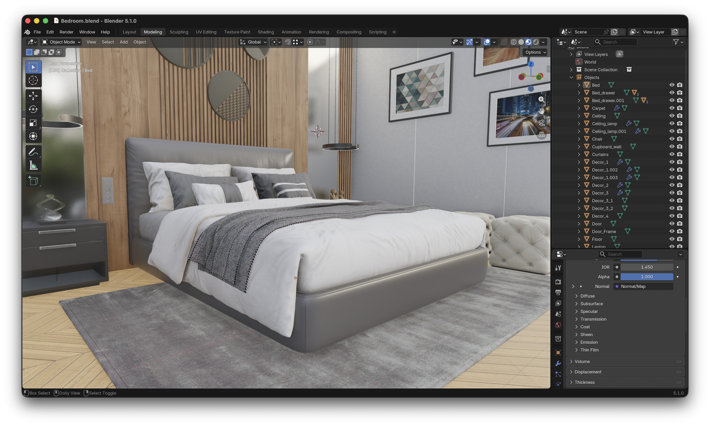
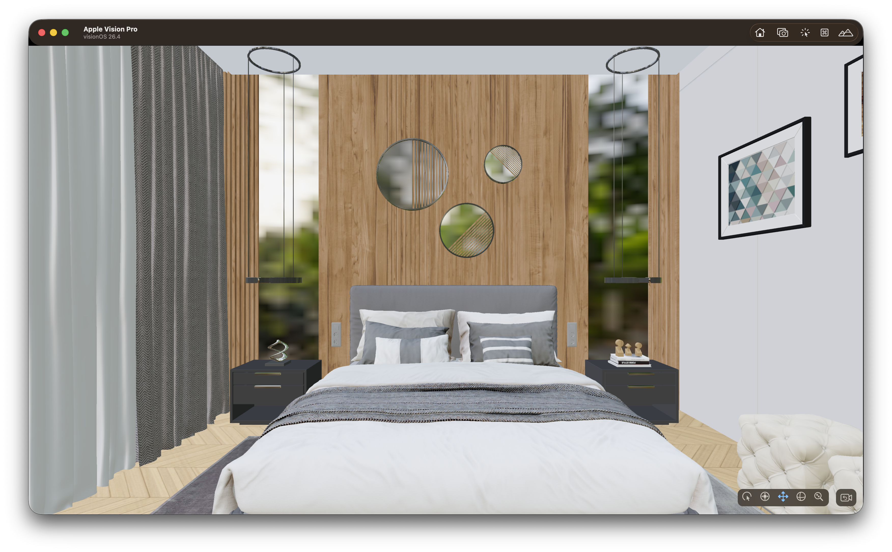
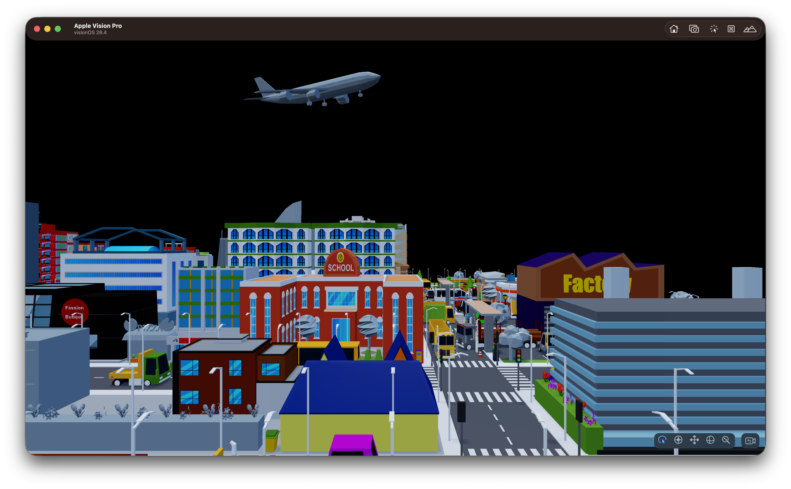

# Building Your First Vision Pro Scene

> **New here?** This guide assumes you already have a project with a cube you
> can reference and move — if not, start with
> [Getting Started Making Games — Editor](GettingStartedMakingGamesEditor.md)
> or [Getting Started Making Games — CLI](GettingStartedMakingGamesCLI.md)
> first. Those guides cover creating the project, placing or creating a cube,
> and finding it in code with `findEntity(name:)`.

This guide picks up from there and takes your project to a working Vision Pro
scene: a real exported model with its own lighting and color management, XR
spatial input, and large-scene streaming. You will start with this archviz
model authored in Blender:



By the end, you will be able to render it in the Vision Pro/Simulator. 

If you created your project with a platform other than `visionos`, some
sections below (XR input, Vision Pro build/run) won't apply directly — the
asset-loading and streaming sections still do.

---

## Get Starter Assets

In your project directory, install the Archviz Starter Asset Pack directly
from the CLI:

```bash
cd MyGame
untoldengine assets install starter-archviz
```

The Archviz Starter Pack includes an archviz model ready to run immediately. The CLI downloads the pack and merges its contents into your project's `GameData` folder automatically. If a file already exists you will be prompted before it is overwritten.

To see all available asset packs:

```bash
untoldengine assets list
```

## Loading a Single Asset

Once in your Xcode project, head over to the `init()` function in `Sources/<ProjectName>/GameScene.swift`.

Use `setEntityMeshAsync` to load an `.untold` file as an always-resident asset.
This is the right choice for props, characters, and any object that should stay
in memory for the lifetime of the scene.

> `setEntityMeshAsync` here works whether `Bedroom` exported as a single
> `.untold` or, for a `.blend` scene with more than one independent model, a
> `.untoldpack` — omitting `withExtension` probes for either. `loadSceneAuthored`
> below is different: it only ever resolves a single `.untold` and has no
> effect on a `.untoldpack`, since a pack has no scene-level slot for the
> lights/cameras/color-grade it would bring in — see [Using the Untold Engine
> CLI](../API/UsingUntoldEngineCLI.md#multi-model-blend-scenes--untoldpack).

```swift

//...After configureEngineSystems()

let entity = createEntity()

setEntityMeshAsync(entityId: entity, filename: "Bedroom"){ success in
    if success {
        
        // Load blender authored color management
        loadSceneAuthored(filename: "Bedroom", withExtension: "untold")
        
        // Enable environement settings
        
        setRendering(.environment(.ibl(true)))
        setRendering(.environment(.asset("forest.exr")))
        setRendering(.environment(.intensity(0.9)))
        setRendering(.environment(.visible(true)))
    
        // set scene ready if loading was successful
        setSceneReady(success)
    }
    
}

```

`setEntityMeshAsync` is non-blocking. The completion block fires on the main thread
once the mesh is parsed and uploaded to GPU memory.

---

## Configuring the Engine

Now, let's configure the Untold Engine so that it can accept input gestures along with other important settings:

Head to configureEngineSystems() and make sure to add the following:

```swift 
private func configureEngineSystems() {
    
    gameMode = true
    
    // Register XR input gestures
    registerXREvents()
    setInput(.xr(.pickingBackend(.octreeGPUPreferred)))
    setInput(.xr(.twoHandRotateAxisMode(.dynamicSnapped)))
    setInput(.xr(.sceneReady(true)))
    
    // Enable post processing and anti-aliasing
    setRendering(.postProcessing(.enabled))
    setRendering(.antiAliasing(.msaa))
    setPostFX(.ssao(.enabled(false)))
    
    // Enable super detail textures
    TextureStreamingSystem.shared.apply(.superdetailed)
}
```

## Handle Input

Now let's add logic to the input handling function. For this tutorial, we want to be able to drag the root scene by pinching our fingers, to do so, we call the Spatial Manipulation System, as shown below:

```swift
func handleInput() {
    // Skip logic if not in game mode
    if gameMode == false { return }
    if isSceneReady() == false {return}
   
    let state = getXRSpatialInputState()
            
    // transform scene root.
    // Pinch + Drag to move scene root
    // Two-hands rotate to rotate the scene root
    SpatialManipulationSystem.shared.processAnchoredSceneManipulationLifecycle(
        from: state,
        dragSensitivity: 10.0,
        rotateSensitivity: 1.0
    )
}
```

---

Now, Build and Run. Click on Start Experience and you should see the archviz rendered on either the Vision Pro Simulator or in the actual device.

[](https://vimeo.com/1176995991?fl=ip&fe=ec)

## Loading a Streamed Scene

Now, let's say that you want to load a large scene, for example a city model with many buildings. In those instances, you should render the scene using the Tile Streaming feature of the engine. More especifically, you should use `setEntityStreamScene` to load a large scene that streams tiles in and out of GPU memory based on camera proximity. 

Let's download a Stream Starter Scene

```bash

untoldengine assets install starter-streamed-city

```

To load a Tiled-Stream scene, you need to use `setEntityStreamScene` and pass the `json` extension as shown below.

```swift

//..After configureEngineSystems()


let sceneRoot = createEntity()
setEntityName(entityId: sceneRoot, name: "LowPolyCity")

// Local manifest
setEntityStreamScene(entityId: sceneRoot, manifest: "LowPolyCity", withExtension: "json") { success in
    setSceneReady(success)
}
```

Now, build and run the vision pro app and you should see a streaming city getting rendered. Click the image below for a video.

[](https://vimeo.com/1176823067?share=copy&fl=sv&fe=ci)

## Loading a Remote Streamed Scene

To stream a remote scene, use the same `setEntityStreamScene(...)` API with a URL to your manifest JSON file.

```swift
// Remote manifest (downloaded and cached on demand)
if let url = URL(string: "https://cdn.example.com/City/City.json") {
    setEntityStreamScene(entityId: sceneRoot, url: url) { success in
        setSceneReady(success)
    }
}
```

`setEntityStreamScene` registers lightweight stub entities for every tile in the
manifest, all parented under `sceneRoot` (no geometry is parsed at this point).
`GeometryStreamingSystem` then loads and unloads tile geometry as the camera moves.
See [Tile-Based Streaming](../Architecture/tilebasedstreaming.md) for the full streaming architecture.

> **Legacy overloads** — `loadTiledScene(manifest:)` and `loadTiledScene(url:)` remain
> available for backwards compatibility. They create an internal root entity automatically.

## Using Your Own Assets

Everything up to this point uses the Starter Pack. When you're ready to bring
in your own 3D models instead:

- [Using The Exporter](../API/UsingTheExporter.md) — convert a `.blend`,
  USD/USDZ, or Gaussian splat capture into the engine's `.untold` format,
  single asset or tiled scene
- [Using Blender Addon](../API/UsingBlenderAddon.md) — export `.untold`
  directly from Blender's File menu instead of the CLI
- [Using the Untold Engine CLI](../API/UsingUntoldEngineCLI.md) — `bootstrap`
  for exporter dependencies, `assets install` for starter packs, and the full
  `export`/`export-tiles` flag reference
- [Getting Started Making Games — Editor](GettingStartedMakingGamesEditor.md) —
  `loadUntoldScene(named:)` for loading a `.untoldscene` file authored with
  the Untold Editor

---
