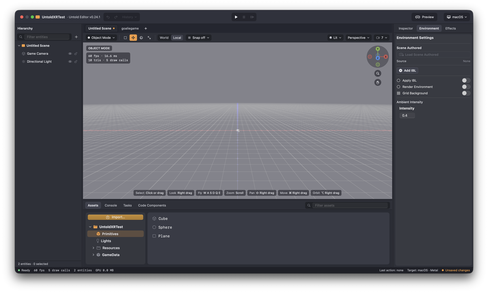

# Getting Started Making Games — Editor

This guide takes you from nothing installed to a running app with a cube you
can move in code, using only the Untold Editor — no command line required.

> Prefer the terminal, or want to script project creation? See
> [Getting Started Making Games — CLI](GettingStartedMakingGamesCLI.md)
> instead. The `untoldengine` CLI is still there if you want it later — the
> Editor's **Create Project** dialog wraps the same project generator.
>
> New to the Editor's panels and viewport controls? See
> [Getting Started With the Editor](GettingStartedWithEditor.md) for a tour
> before diving into project creation.

## Requirements

- macOS 26 or newer
- Swift 6 / Xcode 26 or newer
- Apple Silicon Mac
- Supported platforms: macOS, iOS, and visionOS

## 1. Download the Editor

Grab the latest build from the
[Untold Editor Releases page](https://github.com/untoldengine/UntoldEditor/releases)
and launch it.



## 2. Create a project

From the Editor, choose **Create New Project** and fill in:

- **Project Name** — e.g. `MyGame`
- **Bundle Identifier** — e.g. `com.yourcompany.mygame`
- **Target Platform** — macOS, iOS, iOS AR, visionOS, or Multi-Platform. Pick
  **visionOS** if you plan to continue into
  [Building Your First Vision Pro Scene](BuildingYourFirstVisionProScene.md)
  next.
- **Output** — where the project folder is written

Click **Create**. The Editor generates an Xcode project with its own
`Package.swift` depending on Untold Engine, a `GameData/` asset folder, and a
starter `Sources/MyGame/GameScene.swift` — then opens it as the active
project in the Editor so you can start placing entities right away.

## 3. Place a cube

In the Asset Browser's Primitives shelf, double-click (or drag) the **Cube**
primitive into the viewport. Select it, and in the Inspector rename it to
`Cube` so your code can find it later.

Save the scene with **Cmd+S**, naming it `MyScene`. This writes
`GameData/Scenes/MyScene.untoldscene`.

## 4. Reference the cube and move it in code

Open `MyGame.xcodeproj` and edit `Sources/MyGame/GameScene.swift`. Load the
scene you saved, look up the entity you named, and move it each frame:

```swift
// In init(), after configureEngineSystems()
loadUntoldScene(named: "MyScene") { success in
    guard success else { return }
    if let cube = findEntity(name: "Cube") {
        // Move it 5 units out in front, once, at load time
        translateBy(entityId: cube, position: simd_float3(0, 0, -5))
    }
    setSceneReady(success)
}

// In your per-frame update
func update(deltaTime: Float) {
    guard isSceneReady(), let cube = findEntity(name: "Cube") else { return }
    // Spin it in place at 90°/sec
    rotateBy(entityId: cube, angle: 90 * deltaTime, axis: simd_float3(0, 1, 0))
}
```

`findEntity(name:)` resolves the name you gave the cube in the Inspector
back into an `EntityID` you can drive with the
[Transform System](../API/UsingTransformSystem.md) — `translateBy`,
`translateTo`, `rotateBy`, `rotateTo`, and so on.

## 5. Run it

Press **Run** in Xcode. You should see the cube sitting 5 units out in front,
spinning in place.

## Where to go next

- [Building Your First Vision Pro Scene](BuildingYourFirstVisionProScene.md) — loading your
  own `.untold` assets, streamed scenes, and remote manifests
- [Tutorials](https://untoldengine.github.io/UntoldEngine/Tutorials/) —
  lighting, rendering quality, exporter workflows, XR input
- [Using the Untold Engine CLI](../API/UsingUntoldEngineCLI.md) — if you
  later want to script project creation, export assets, or install asset
  packs from the terminal

If your team is evaluating Untold Engine and needs an engine capability that
is not currently available, see
[Commercial Use, Sponsored Features, and Support](https://github.com/untoldengine/UntoldEngine/blob/main/COMMERCIAL.md).
